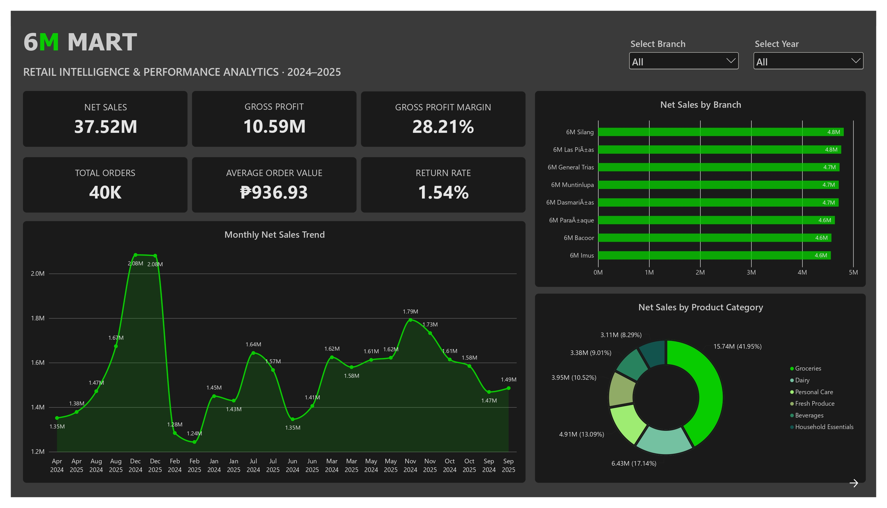
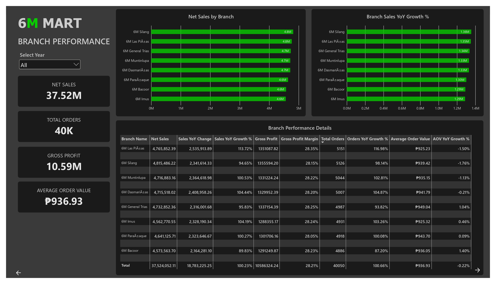
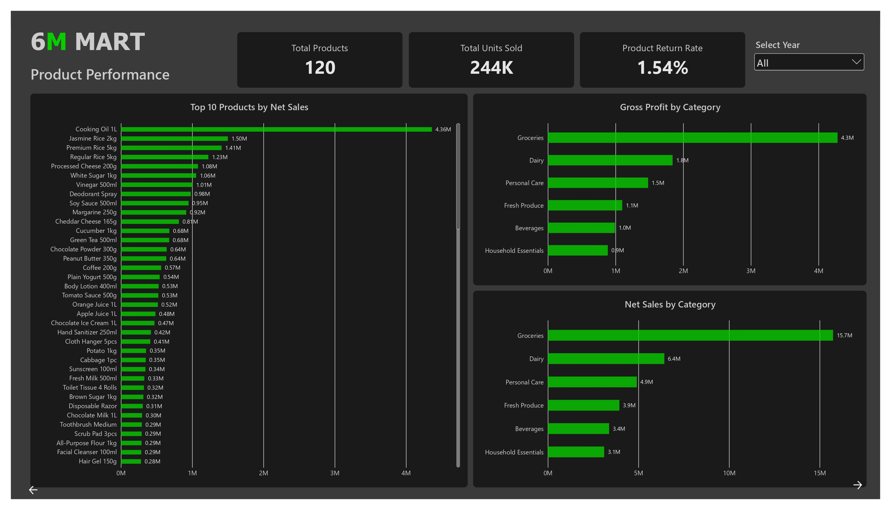
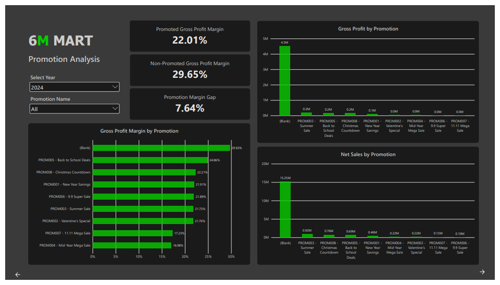
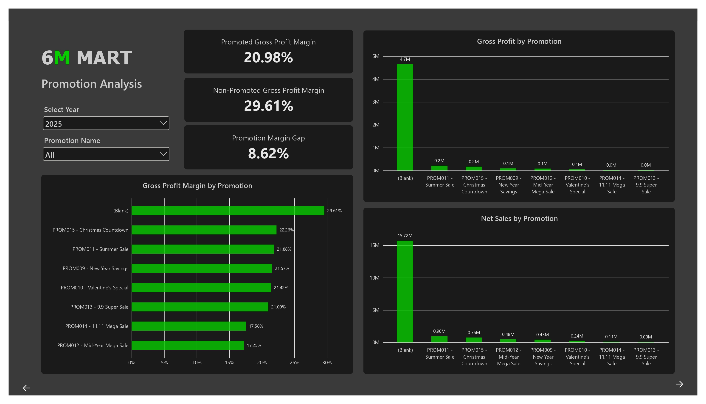
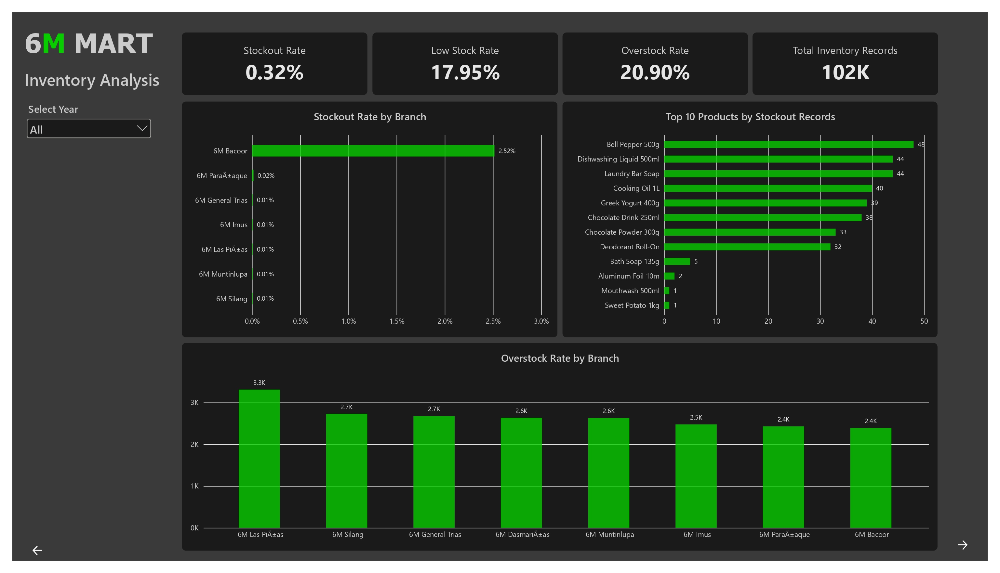
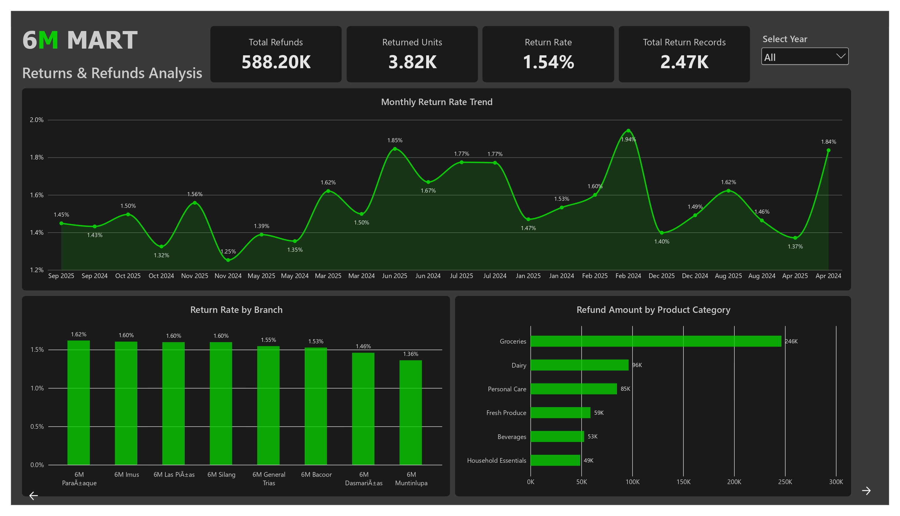
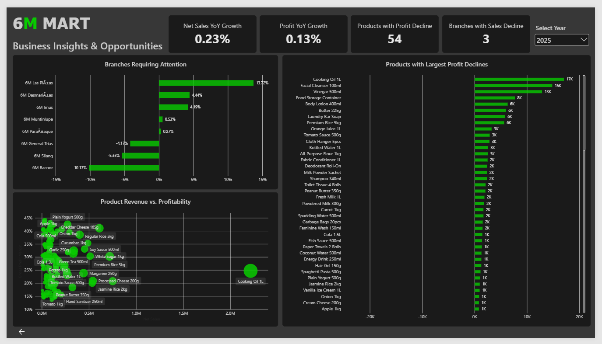

# 6M Mart – Retail Intelligence & Performance Analytics

An end-to-end Business Intelligence project analyzing two years of retail operations across eight fictional supermarket branches in the Philippines.

The project demonstrates a complete analytics workflow, from synthetic data generation and data preparation to PostgreSQL database management, SQL business analysis, and interactive Power BI dashboards.

> **Disclaimer:** This project uses synthetic data generated for educational and portfolio demonstration purposes. It does not contain actual business transactions or customer records.

---

## Project Overview

6M Mart is a fictional supermarket chain operating eight branches across Cavite and Metro Manila.

The objective of this project is to develop a centralized Business Intelligence solution that helps management monitor sales performance, evaluate profitability, identify inventory concerns, and discover opportunities for operational improvement.

**Business Role:** Business Intelligence Analyst  
**Reporting Audience:** Operations Director  
**Analysis Period:** January 2024 – December 2025  
**Currency:** Philippine Peso (PHP)

## Tools & Technologies

| Technology | Purpose |
|---|---|
| Python | Synthetic data generation and data preparation |
| Pandas & NumPy | Data manipulation and validation |
| PostgreSQL | Relational database management |
| SQL | Business analysis and KPI calculations |
| Power BI | Interactive dashboards and reporting |
| DAX | Measures and time-based calculations |
| Microsoft Excel | Supporting data review and validation |

## Project Workflow

1. **Data Generation** – Created synthetic retail datasets using Python.
2. **Data Preparation** – Cleaned, transformed, and validated the generated records.
3. **Database Development** – Designed and populated a relational database in PostgreSQL.
4. **SQL Analysis** – Developed 37 analytical queries covering eight business analysis areas.
5. **Dashboard Development** – Built seven interactive Power BI report pages using DAX.
6. **Business Insights** – Identified performance trends, operational concerns, and improvement opportunities.

## Dataset Overview

The project contains eight interconnected datasets with a combined total of **225,118 records**.

| Dataset | Records |
|---|---:|
| Branches | 8 |
| Suppliers | 15 |
| Products | 120 |
| Promotions | 15 |
| Date Dimension | 731 |
| Sales Line Items | 120,000 |
| Inventory Records | 101,760 |
| Return Records | 2,469 |
| **Total** | **225,118** |

The dataset covers sales, products, branches, suppliers, promotions, inventory snapshots, and product returns.

## Power BI Dashboard Contents

The interactive report contains seven pages:

1. Executive Overview
2. Branch Performance
3. Product Performance
4. Promotion Analysis 2024
5. Promotion Analysis 2025
6. Inventory Analysis
7. Returns & Refunds Analysis
8. Business Insights & Opportunities

## Power BI Dashboard

### 1. Executive Overview


### 2. Branch Performance


### 3. Product Performance


### 4. Promotion Analysis — 2024


### 5. Promotion Analysis — 2025


### 6. Inventory Analysis


### 7. Returns & Refunds Analysis


### 8. Business Insights


## Key Business Findings

The analysis identified several notable findings:

- **₱37.52 million in net sales** generated across the two-year period.
- **28.21% gross profit margin** across the business.
- **0.23% net sales growth** in 2025 compared with 2024.
- **6M Las Piñas** recorded the highest branch sales growth at 13.72%.
- **6M Bacoor** experienced the largest branch sales decline at -10.17%.
- **Groceries** contributed the largest category sales share at 41.95%.
- **Personal Care** recorded the highest category gross profit margin at 30.17%.
- Promoted sales had a lower observed gross profit margin than non-promoted sales.
- Inventory analysis identified recurring stockout and overstock conditions across branches.

These findings support recommendations involving branch performance reviews, product profitability, promotional efficiency, and inventory management.

## Repository Structure

```text
6M-Mart-BI-Project/
│
├── 01_Project_Documentation/
│   └── project_overview.md
│
├── 02_Raw_Data/
│
├── 03_Python/
│
├── 04_Cleaned_Data/
│
├── 05_SQL/
│
├── 06_PowerBI/
│
├── 07_Insights_and_Reports/
│   ├── business_findings.md
│   ├── business_findings_report.md
│   └── dashboard_screenshots/
│
└── README.md
```

## Project Deliverables

- Python scripts for data generation and preparation.
- Eight synthetic retail datasets.
- PostgreSQL relational database.
- 37 SQL business analysis queries.
- Interactive Power BI report with seven pages.
- Business findings and recommendations report.
- Project documentation and dashboard screenshots.

## Analytical Limitations

- The datasets are synthetic and do not represent actual retail operations.
- Findings are descriptive and do not establish causal relationships.
- Inventory data consists of weekly snapshots and cannot establish exact stockout duration or lost sales.
- Return reasons and customer-level information are not available.
- Promotional comparisons should be interpreted with the documented campaign-level reconciliation caveat.

## Author

**Marc Andrie M. Pabello**  
BS Computer Science | Emilio Aguinaldo College–Cavite

**Project Category:** Business Intelligence / Data Analytics  
**Year:** 2026
